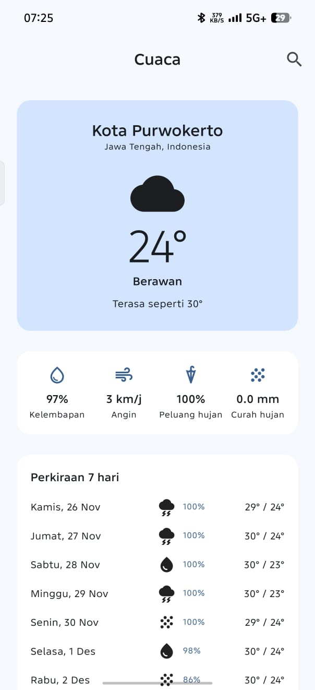
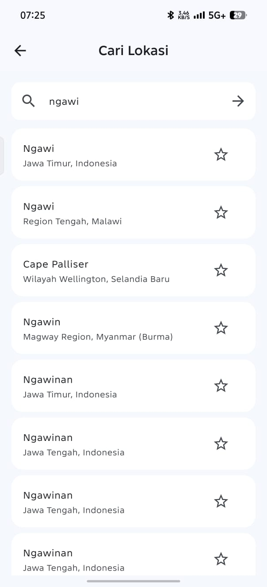

# Cuaca

Aplikasi cuaca sederhana berbasis Flutter untuk Responsi Pemrograman Mobile. Data cuaca dan pencarian kota diambil dari Open-Meteo API.

Nama : (isi nama)
NIM  : (isi NIM)

## Fitur

- Menampilkan cuaca saat ini: suhu, suhu terasa, kondisi cuaca, kelembapan, kecepatan angin, dan curah hujan
- Perkiraan cuaca 7 hari ke depan (suhu maks/min, peluang hujan)
- Cari kota lewat Geocoding API
- Simpan kota favorit
- Lokasi terakhir dan favorit tetap ada setelah aplikasi ditutup dan dibuka lagi
- Tampilan loading, data kosong, dan error (dengan tombol coba lagi)

## Screenshot

Weather Screen



Search Screen



## Struktur Aplikasi

```
lib/
├── main.dart
├── core/
│   ├── theme/app_theme.dart
│   └── utils/weather_code.dart
├── models/
│   ├── location_model.dart
│   └── weather_model.dart
├── services/
│   ├── geocoding_service.dart
│   ├── weather_service.dart
│   └── local_storage_service.dart
├── viewmodels/
│   ├── weather_viewmodel.dart
│   └── search_viewmodel.dart
└── views/
    ├── weather_screen.dart
    ├── search_screen.dart
    └── widgets/
        ├── current_weather_card.dart
        ├── detail_info_row.dart
        ├── forecast_list.dart
        └── state_views.dart
```

## Implementasi API

Ada dua endpoint Open-Meteo, keduanya lewat request GET memakai package `http`.

1. Geocoding API, untuk mencari kota berdasarkan nama.
   `https://geocoding-api.open-meteo.com/v1/search?name=<kota>`
   Dipanggil di `geocoding_service.dart`. Kalau kota tidak ditemukan, API tidak mengirim key `results`, jadi dianggap hasil kosong.

2. Forecast API, untuk cuaca berdasarkan latitude dan longitude.
   `https://api.open-meteo.com/v1/forecast`
   Dipanggil di `weather_service.dart` dengan parameter:
   - current: temperature_2m, relative_humidity_2m, apparent_temperature, precipitation, weather_code, wind_speed_10m
   - daily: weather_code, temperature_2m_max, temperature_2m_min, precipitation_probability_max
   - timezone=auto, forecast_days=7

Response JSON diubah ke model Dart di `weather_model.dart` dan `location_model.dart`. Data `daily` dari API berbentuk list per field, jadi digabung per index menjadi satu objek `DailyForecast` untuk tiap hari. Semua request diberi timeout 10 detik.

## Penerapan MVVM

- Model: `LocationModel`, `WeatherModel` (beserta `CurrentWeather` dan `DailyForecast`). Isinya data dan parsing JSON.
- Service: urusan request HTTP dan penyimpanan lokal. Tidak tahu apa-apa soal tampilan.
- ViewModel: `WeatherViewModel` dan `SearchViewModel` memakai `ChangeNotifier`. Menyimpan state (`loading`, `error`, `success`, `empty`), memanggil service, lalu `notifyListeners()`.
- View: `WeatherScreen` dan `SearchScreen` hanya menampilkan data sesuai status ViewModel dan memanggil method-nya. Tidak ada request API di dalam View.

State management memakai Provider. Kedua ViewModel didaftarkan lewat `MultiProvider` di `main.dart`.

## Penyimpanan Lokal

Memakai `shared_preferences` (`local_storage_service.dart`). Yang disimpan:
- daftar lokasi favorit (list string JSON)
- lokasi terakhir yang dipilih, supaya langsung tampil saat aplikasi dibuka lagi

Kalau belum pernah memilih kota, lokasi awal adalah Purwokerto. Itu hanya koordinat awal, data cuacanya tetap diambil dari API.

## Cara Menjalankan

```
flutter pub get
flutter run
```

Dependency: `http`, `provider`, `shared_preferences`, `intl`.

## Catatan

- Butuh koneksi internet
- Weather code (WMO) dari API dipetakan ke teks dan ikon di `weather_code.dart`
